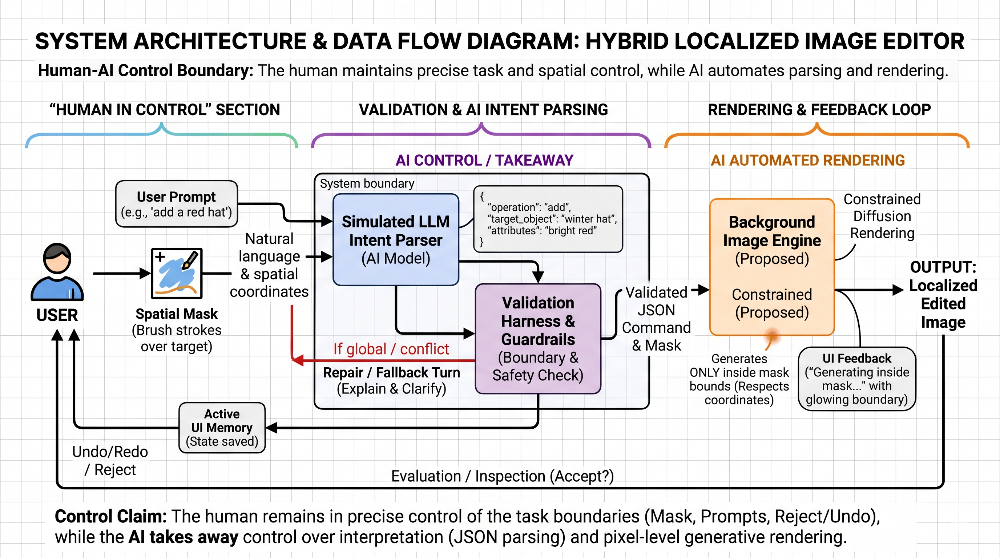

## 01_SPEC.md: use case and system path

Use this file for the use case from your Week 2 storyboard. Keep the notes short enough to use while you work.

## User goal
<What is the person trying to achieve?>
Edit a specific detail in an AI-generated image (e.g., adding a red hat to a cat) with precise spatial control, rather than risking unpredictable global changes.

## System inputs
<What does the person provide, and what data or context does the system receive?>
The system receives two inputs simultaneously:
1. A short natural language text prompt (e.g., "Add a bright red winter hat").
2. The spatial mask coordinates painted by the user over the target area (e.g., the cat's head).

## Processing and technology
<What does the system extract, look up, classify, generate or decide? Which model, tool, data source or software component would carry out each important step?>
The system uses an LLM (e.g., Gemini) as an intent parser. The LLM component extracts the core editing instruction from the text prompt and outputs a structured JSON command (containing `operation`, `target_object`, and `attributes`). A background image-editing engine then applies this generated content strictly within the boundaries of the provided spatial mask coordinates.

## Intended result and next action
<What does the system return, and what can the person do next?>
The system returns the updated image with the requested edit perfectly confined to the masked area. The person can visually inspect the result and choose to accept it or click 'Undo' to try again.

## Fallback strategy
<What happens if information is missing, ambiguous, outside the system's scope or unavailable?>
If the text prompt is ambiguous, contradicts the spatial mask, or violates safety boundaries, the LLM must not guess or hallucinate. Instead, it must return an error status in the JSON. The system will then trigger a repair turn, pausing the generation and asking the user for clarification (e.g., "I see the mask, but your prompt is unclear. What should I add here?").

## System path or interaction diagram
Add a flowchart, use case diagram or system architecture sketch showing the person, input, processing, data or model or tool, response and next action. Label anything that is implemented, simulated or still planned.

## Review and revision
Use the tests to identify an interaction or system problem. Note the evidence, then describe one interaction change and one technology or system change. Explain why the changes help and run Test B again.

**System Path Review:**
- **Did it extract the information it needed to operate?** Yes, in Test A, the LLM successfully extracted the "operation" (add), "target_object" (winter hat), and "attributes" (bright red) from the user's prompt.
- **Did it invent missing information not in the input?** No, the LLM strictly parsed only the explicit details provided in the prompt and did not hallucinate additional attributes.
- **Did it ask for missing information instead of guessing?** In Test B, instead of guessing how to apply a global style change locally, the system correctly executed the fallback strategy by returning an "error" state.
- **Did it step beyond its bounds and take over?** No, the LLM stayed strictly within its role as an intent parser, outputting only the requested JSON format without executing unauthorized actions or adding conversational filler.
- **Did it respond to the person via a useful, task-orientated search and synthesis?** N/A for this specific parser component, as it translates commands for the backend engine rather than searching external databases.

**Identified Problem & Revisions:**
**Evidence of problem:** While Test B successfully triggered an error for global changes, the system currently lacks a way to handle *multiple* local edits in a single prompt (e.g., "Add a red hat and blue shoes"). The JSON schema only allows for one "target_object".
**Interaction change:** I will update the interaction flow so that if a user asks for multiple edits in one prompt, the system will prompt them to perform one masked edit at a time to maintain precise spatial control.
**Technology/system change:** I will modify the System Prompt's JSON schema to make "target_object" an array. If the array length is > 1, the LLM will trigger a new specific error: "Please apply edits one at a time for precise mask control."